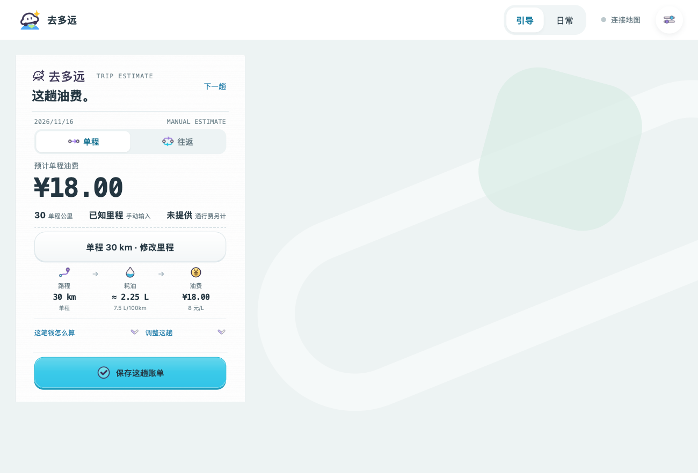

# 去多远

**出发前，先算这趟的油费。**

输入里程就能估算油费。连接地图后，可以比较驾车路线，或用一笔预算、一段时间看看大概能到哪里。

[下载 Mac 预览版](https://github.com/zjyart/quduoyuan/releases/tag/mac-v2.3.31-preview.1) · [开始使用](docs/getting-started.md) · [反馈问题](SUPPORT.md)

Mac 2.3.31 预览版使用临时签名，尚未完成 Apple 公证，macOS 可能阻止打开。iPhone TestFlight 尚未开放。

*Mac 版实拍。示例为单程 30 公里、百公里油耗 7.5 升、油价 8 元/升，预计油费 18 元。*

## 可以做什么

- **算一趟油费：** 选地点或输入里程，用自己的油耗和油价计算；通行费单独列出。
- **比较驾车路线：** 地图可用时，按距离、用时、油费和通行费比较候选路线。
- **看看能去多远：** 以预算或时间探索大致范围；点选具体地点，再按返回的路线核算。
- **留一张出行小票：** 查看路程、耗油量和费用的计算依据，按版本支持保存图片或账单数据。

实际开销会随车况、路况和油价变化。地图探索的边界是估算，用于出发前参考。应用需要联网核验发行状态；核验通过后，已知里程的油费计算不需要连接地图。

[常见问题](docs/faq.md) · [隐私说明](docs/privacy.md) · [版本记录](CHANGELOG.md)

本仓库用于发布「去多远」的安装包、说明和版本记录。应用不按开源许可发布。GitHub 在 Releases 自动生成的 `Source code` ZIP 和 TAR 是这个发行仓库的归档。安装 Mac 版时请选择 Releases 的 `.dmg` 附件。详见[权利与第三方组件说明](NOTICE.txt)。
