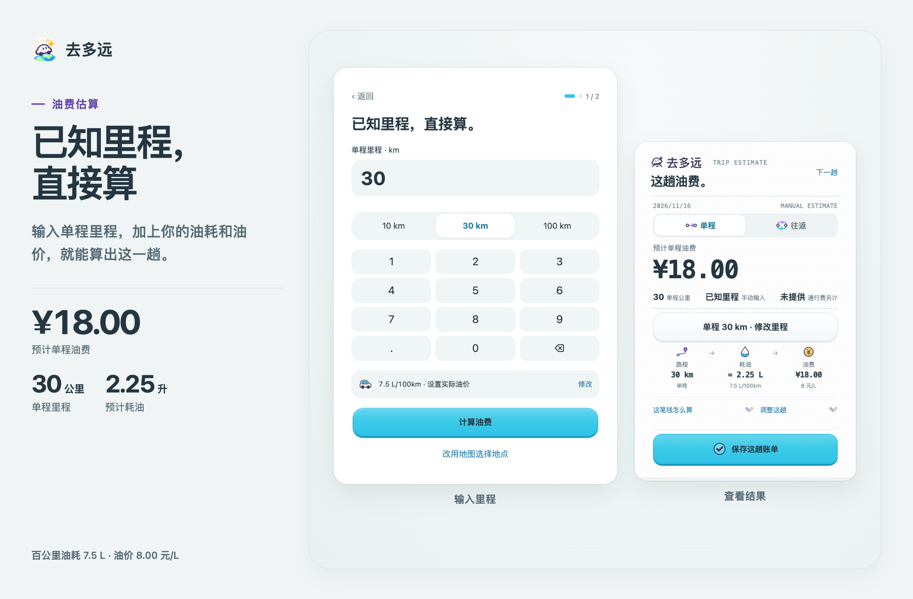
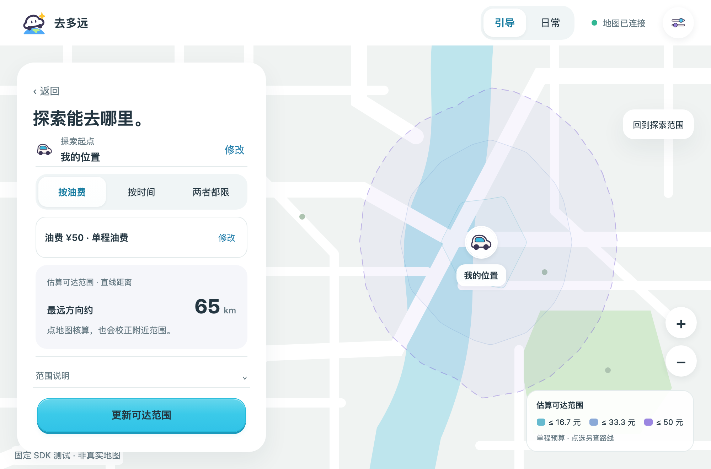
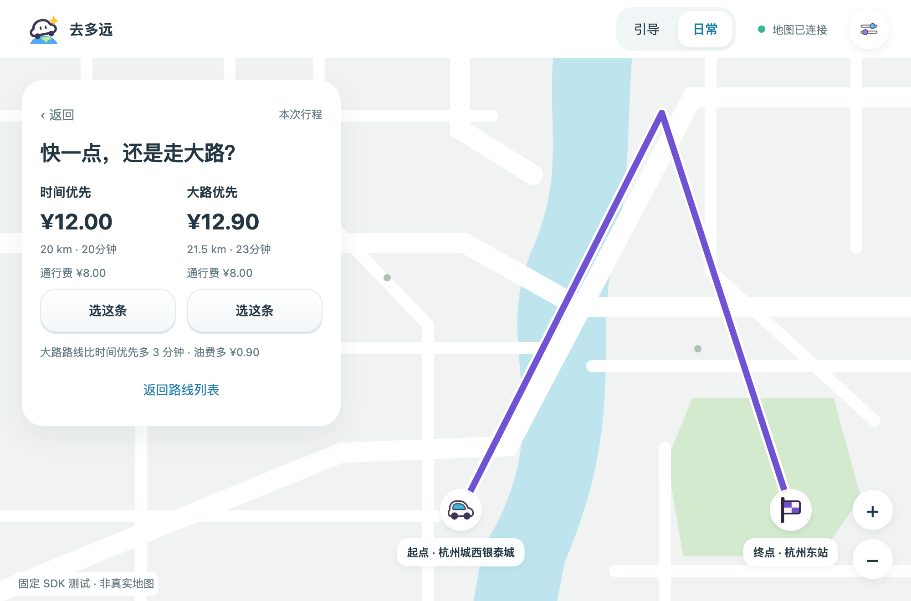
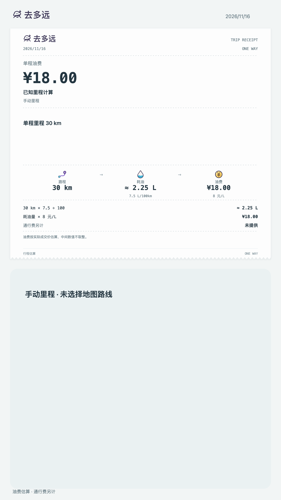
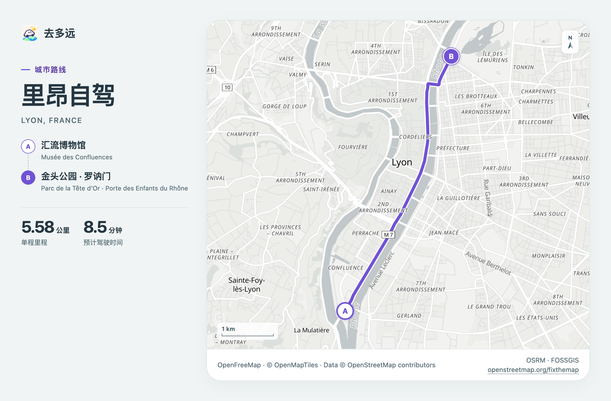
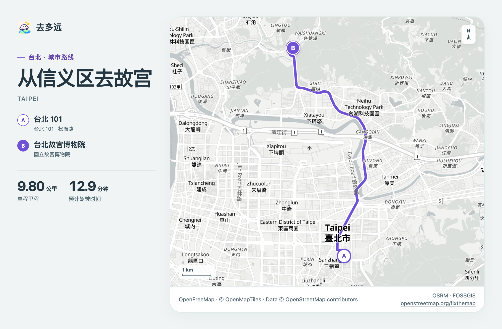
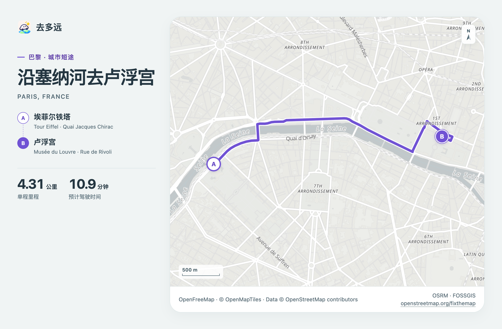
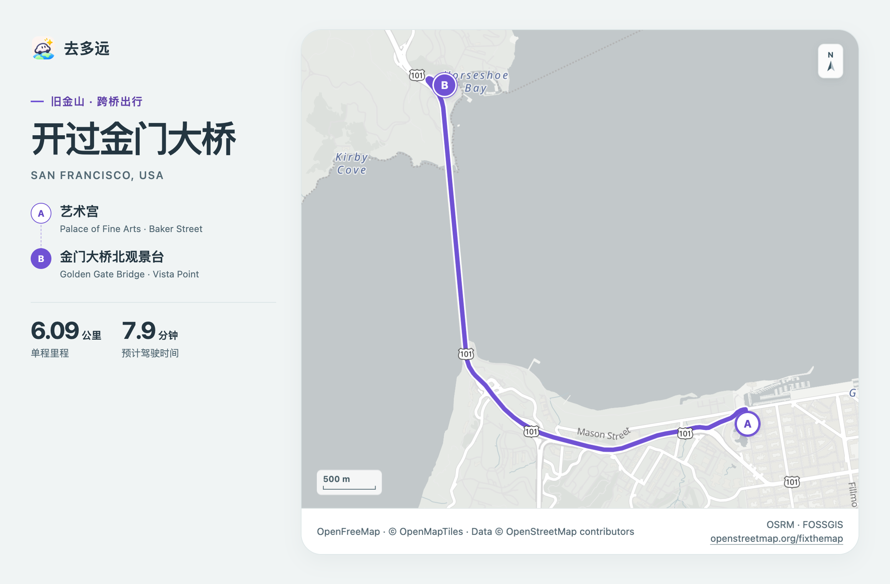

# 去多远

**出发前，先算这趟的油费。**

输入里程就能估算油费。连接地图后，可以比较驾车路线，或用一笔预算、一段时间看看大概能到哪里。

[下载 Mac 预览版](https://github.com/zjyart/quduoyuan/releases/tag/mac-v2.3.31-preview.1) · [开始使用](docs/getting-started.md) · [连接高德地图](docs/amap-setup.md) · [反馈问题](SUPPORT.md)

Mac 2.3.31 预览版使用临时签名，尚未完成 Apple 公证，macOS 可能阻止打开。iPhone TestFlight 尚未开放。

## 从出发到算清

**直接算油费。** 已知里程时，输入路程、百公里油耗和每升油价即可计算。比如单程 30 公里，百公里油耗 7.5 升，油价 8 元/升，预计油费为 18 元。

| 按油费或时间探索 | 比较驾车路线 |
| :--- | :--- |
|  |  |
| 还没决定去哪儿时，先设置起点和预算，在地图上看大致可达范围。 | 定好目的地后，比较各条路线的距离、时间、油费和通行费。 |

*上面两张地图界面使用演示数据。可达范围是估算，到具体地点的费用以路线核算结果为参考。*

**留下行程小票。** 把本次里程、预计耗油和费用保存下来，便于对照或分享。[查看 Mac 窗口实拍](assets/mac-trip-estimate.png)

查看导出的行程小票

 

## 四城驾车路线

| 里昂 · 汇流博物馆到金头公园 | 台北 · 从信义区去故宫 |
| :--- | :--- |
|  |  |

| 巴黎 · 沿塞纳河去卢浮宫 | 旧金山 · 开过金门大桥 |
| :--- | :--- |
|  |  |

底图由 [OpenFreeMap](https://openfreemap.org/) 提供，© [OpenMapTiles](https://openmaptiles.org/) · 数据 © [OpenStreetMap contributors](https://www.openstreetmap.org/copyright)。路线由 [FOSSGIS / OSRM](https://routing.openstreetmap.de/about.html) 计算。[纠正地图](https://www.openstreetmap.org/fixthemap)

## 连接高德地图

地图选点、地点搜索、路线比较和范围探索需要连接高德。请在高德开放平台申请你自己的 **Web 端（JS API）Key** 和配套**安全密钥**，再从应用右上角的「连接地图」填写。已知里程可直接算油费。[查看申请步骤和应用内设置](docs/amap-setup.md)

## 品牌与图标

| 白天标志 | 夜间标志 | 春日花路 | 河湾公路 |
| :---: | :---: | :---: | :---: |
|  |  |  |  |

| 搜索 | 收藏 | 路程 | 范围探索 | 往返 | 小型车 |
| :---: | :---: | :---: | :---: | :---: | :---: |
|  |  |  |  |  |  |

[查看截图与品牌图说明](assets/README.md)

[常见问题](docs/faq.md) · [隐私说明](docs/privacy.md) · [版本记录](CHANGELOG.md)

本仓库用于发布「去多远」的安装包、说明和版本记录。应用不按开源许可发布。GitHub 在 Releases 自动生成的 `Source code` ZIP 和 TAR 是这个发行仓库的归档。安装 Mac 版时请选择 Releases 的 `.dmg` 附件。详见[权利与第三方组件说明](NOTICE.txt)。
