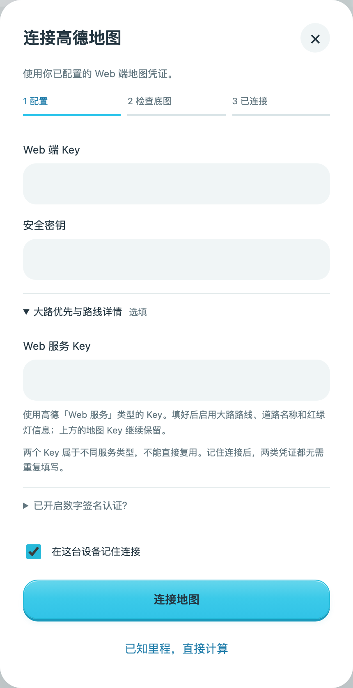

# 连接高德地图

在去多远 Mac 预览版里，地图、地点搜索、基础驾车路线和范围探索使用高德地图服务。请用自己的高德开放平台账号申请凭证，填在应用的地图连接窗口中。只想按已知里程算油费时，完成应用的版本核验后，选「已知里程，直接计算」即可。

## 申请并连接基础地图

1. 登录[高德开放平台控制台](https://console.amap.com/dev/key/app)。首次使用时，按高德提示注册开发者账号。
2. 在「应用管理」创建应用，然后选择「添加 Key」。服务平台选「Web 端（JS API）」，从同一条配置获取 Key 和安全密钥。[高德 JS API 2.0 申请指南](https://lbs.amap.com/api/javascript-api-v2/prerequisites)
3. 打开去多远，点击右上角「连接地图」。在「连接高德地图」窗口的「Web 端 Key」填入 Key，在「安全密钥」填入与它配套的安全密钥。
4. 再点击「连接地图」。顶栏显示「地图已连接」后，可以用两个公开地点试一次普通驾车路线。使用「按油费 / 时间探索」之前，也先确认基础地图可以连接。

「在这台设备记住连接」默认勾选。勾选时，配置保存在本机应用数据中，供下次启动使用。只想本次使用时，在点击「连接地图」前取消勾选。已记住的配置也可以在「地图已连接」里重新打开连接窗口，取消勾选后重新连接。更换 Web 端凭证时，应用可能重新加载页面，并在这次重载期间暂存连接信息。

## 大路优先与路线详情（选填）

1. 在高德控制台再添加一个 Key。这次服务平台选「Web 服务」。[高德 Web 服务 Key 申请指南](https://lbs.amap.com/api/webservice/create-project-and-key)
2. 在去多远的连接窗口展开「大路优先与路线详情」，把这次申请的 Key 填进「Web 服务 Key」，上方的两项基础地图凭证也要保留。[高德驾车路径规划 2.0](https://lbs.amap.com/api/webservice/guide/api/newroute)
3. 如果这把 Web 服务 Key 已启用数字签名，展开「已开启数字签名认证？」，填写同一个 Key 对应的「Web 服务签名私钥」。未启用时留空。上方的「安全密钥」来自另一条 JS API 配置。[高德数字签名说明](https://lbs.amap.com/faq/quota-key/key/41181/)

连接成功表示底图已加载，Web 服务凭证会在实际算路时验证。它用于「大路优先」以及可用的道路名称和红绿灯信息，具体以高德返回的路线为准。

## 连接失败时

- **底图加载失败**。先检查网络，以及「Web 端 Key」和「安全密钥」是否来自同一条高德配置。Mac 预览版从本地文件加载界面，绑定特定网站域名的 Key 可能因高德的来源校验而无法使用。Web 服务 Key 的 IP 白名单也可能限制算路。如果现有配置不适用于这个版本，可以先用已知里程计算，并向高德或去多远确认支持方式。[高德错误码说明](https://lbs.amap.com/api/webservice/guide/tools/info/)
- **底图正常，算路报错**。`10009` 时核对是否选错 Key 类型，`10007` 时核对 Web 服务签名私钥。遇到调用额度或权限问题，可到高德控制台查看当前 Key 的服务权限和配额。若只需要普通路线，也可以暂不配置选填的 Web 服务信息。
- **定位失败**。可以在地图上选择起点。已选定起点后再搜索目的地。

凭证只在自己的应用里填写。反馈时提供去多远版本、macOS 版本、出错步骤和错误编号即可。请遮住地图 Key、安全密钥、签名私钥、地址和坐标，避免发送完整请求 URL、网络日志或高德控制台的原始截图。如果凭证已泄露，请在高德控制台停用并更换。生产环境的凭证应保留在受控系统里，高德推荐由服务器保护 JS API 安全密钥。[去多远反馈入口](../SUPPORT.md) · [高德安全密钥使用说明](https://lbs.amap.com/api/javascript-api-v2/guide/abc/jscode)
